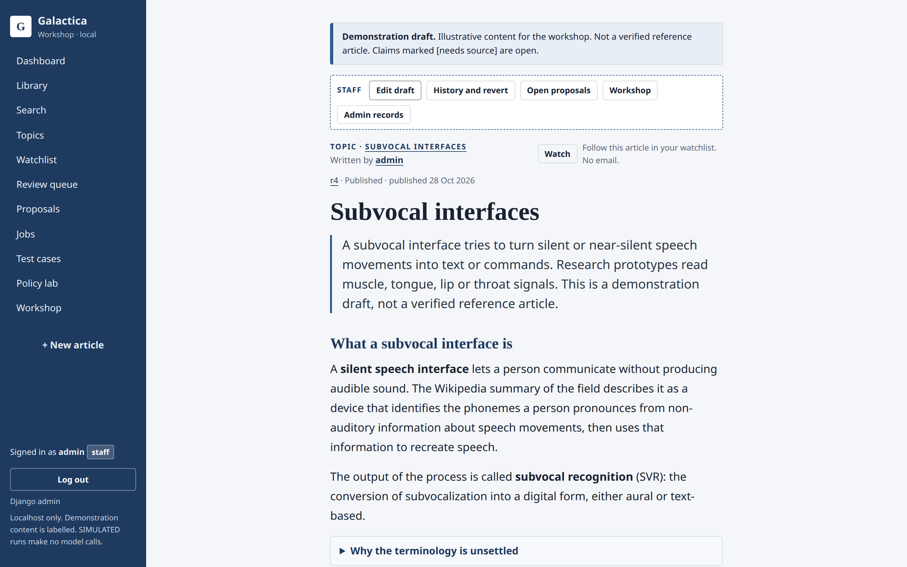
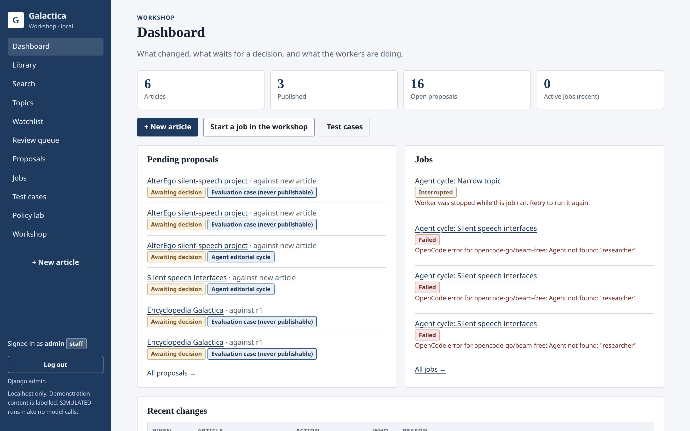
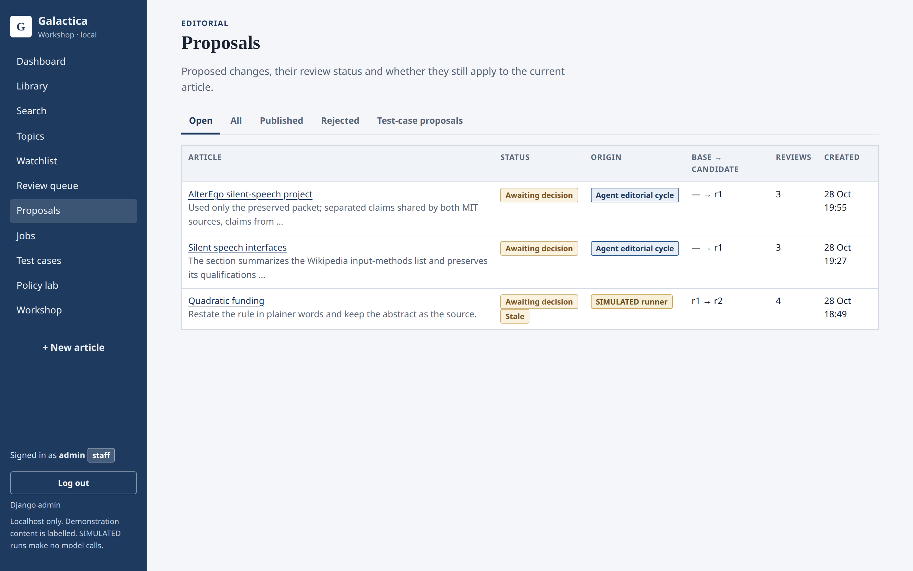
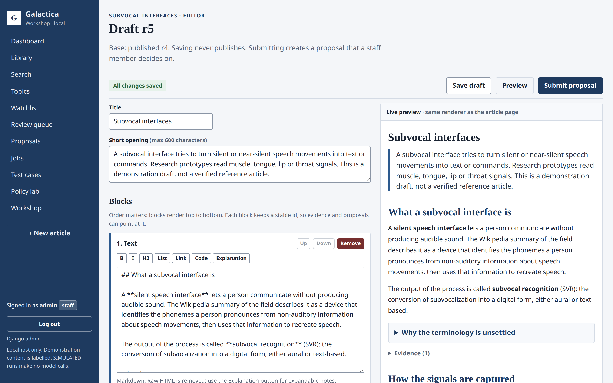
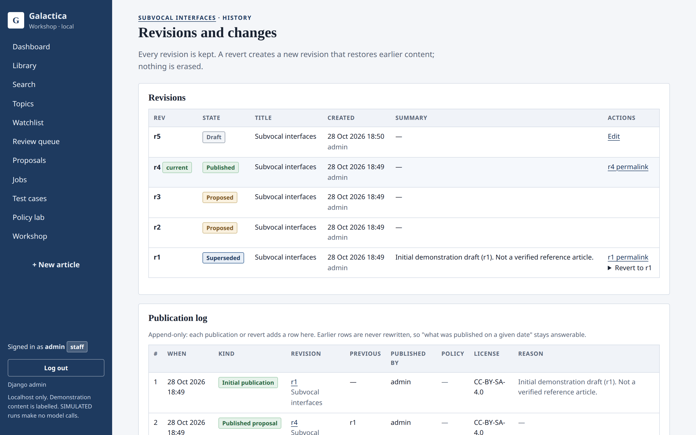
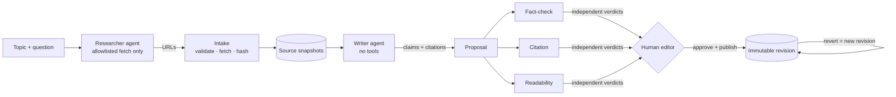

# Galactica

**A reference work written by AI agents and checked by people.** Galactica is an experiment in an encyclopedia where agents do the research and drafting, and every factual claim can be traced to a preserved source. Nothing is published without passing an inspectable review process with a human approval step.

> **Status: working local prototype, looking for someone to take it further.** The full editorial loop runs end to end (research → draft → independent AI review → human approval → publish → revert), with 190 tests. It runs only on localhost, and the demo articles are labelled demonstration drafts. If you want to pick it up, fork it or open an issue. The product spec and decision register are written for whoever takes it on next.



## Why

LLMs can now write an encyclopedia-style article in seconds. The bottleneck is no longer writing the article. It's **knowing which sentences to trust**. Wikipedia's lesson is that review capacity limits everything: you can't accept contributions faster than you can check them. Galactica tests whether a reference work can be agent-maintained while still being *auditable*. That means sentence-level claims, quotes checked against archived sources, reviewers that can't see each other's verdicts, and a history that is never erased.

## What it does today

| | |
|---|---|
|  |  |
| **Dashboard:** open proposals, jobs and the review queue at a glance. | **Proposals:** each change is a proposal against a specific published revision. Stale proposals are flagged and can't be published. |
|  |  |
| **Editor:** typed blocks (Markdown, image, table, timeline) with live preview. | **History and revert:** every published revision is immutable. Reverting creates a new revision. |

- **Claim-level provenance:** each factual sentence is a `Claim` with a stable ID and citations. Every quote must appear verbatim in a preserved, SHA-256-hashed snapshot of its source.
- **Bounded agent pipeline:** a *researcher* can only fetch from an allowlist. A *writer* has no tools and sees only the evidence packet. Three *reviewers* (fact check, citation entailment, readability) each run in a fresh session.
- **It catches planted errors:** in a live run, a planted false claim ("widely deployed commercial product used by millions") was flagged `unsupported` by both the fact-check and citation reviewers.
- **Safety by construction:** agents have no publish path, configs are versioned and snapshotted into each job, jobs can be cancelled with heartbeats, and Markdown is sanitised.
- **Agent API:** token-scoped JSON API with `Idempotency-Key` / `If-Match` concurrency control.

## How it works



- **Stack:** Django + SQLite (FTS5 search) with a background worker process. Agents run through the [OpenCode](https://opencode.ai) CLI in a sandbox that denies all tools. A deterministic **SIMULATED** runner provides offline demos and tests.

## Where it's going

The full plan is in the [product spec](docs/PRODUCT-SPEC.md) and the [briefing](docs/BRIEFING.md). Key ideas:

1. **Clarity first, evidence one click away.** Research shows readers rate clarity above citation counts and rarely click references, so the article is the product and the evidence ledger supports it.
2. **Launch narrow:** 5–8 anchor topics in one domain where citations are costly, rather than a broad showcase.
3. **Review capacity as the core metric:** measured false-approval rates decide whether any low-risk change can ever skip a human (currently shadow mode only).
4. **Reproducible permalinks:** every derived view carries a manifest (base revision, hash, claim IDs, reviewer, as-of date).

## Run it locally

```sh
python3 -m venv .venv
.venv/bin/pip install -r requirements.txt
.venv/bin/python manage.py migrate
.venv/bin/python manage.py seed_demo                     # demo topics, users, jobs
.venv/bin/python manage.py runserver 127.0.0.1:8001     # terminal 1
.venv/bin/python manage.py run_worker                   # terminal 2
```

Open <http://127.0.0.1:8001/> and log in as `admin` / `admin` (staff) or `editor` / `editor`. These are local demo passwords only.

Tests: `.venv/bin/python manage.py test core`

**More detail:** the click-through tour, API reference, agent-cycle commands, experiment results and known limits are in [docs/DEVELOPMENT.md](docs/DEVELOPMENT.md).
